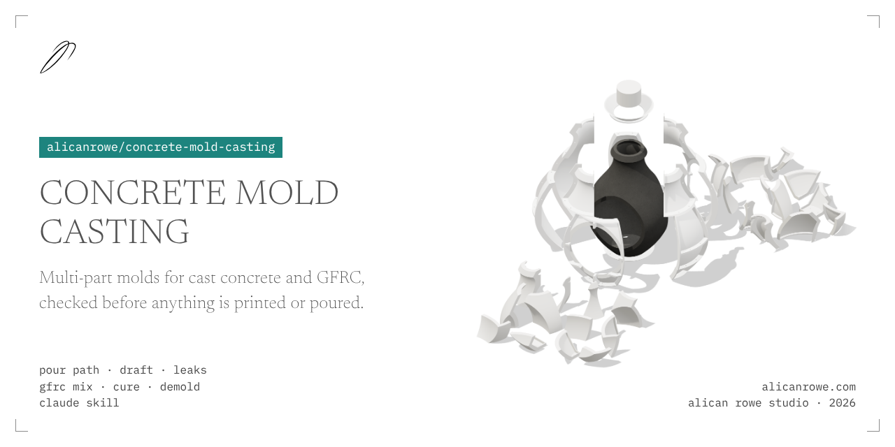
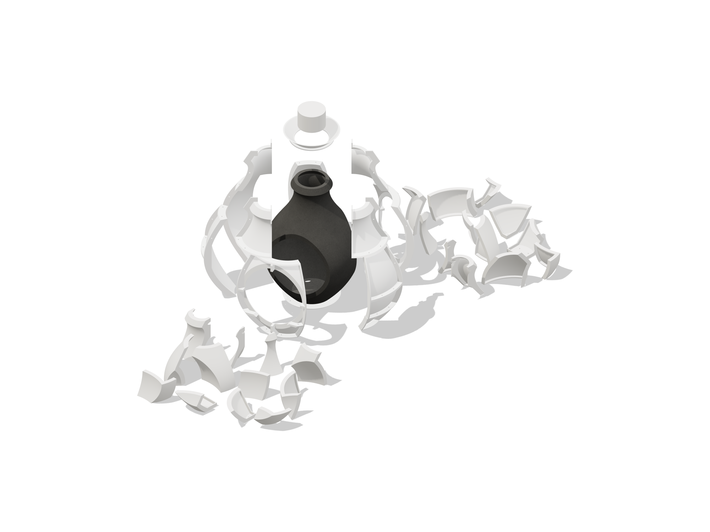

# Concrete mold casting skill



A Claude skill for designing multi-part molds for cast concrete and GFRC, checking the mold model before printing or pouring, and planning the mix, pour, cure, demold and a small production run.

## What's in it
- **`SKILL.md`**: the workflow Claude follows: read the rules, design the mold, check it, then plan the mix and the run.
- **`references/`**
  - `mold-design.md`:
    - mold families: printed or CNC negatives, silicone gloves with a mother mold, fiberglass
    - wall and floor thickness
    - parting lines and pulls, draft, core segmentation
    - flanges and bolts, hydrostatic force and core uplift
    - fill, vents and risers, release, printing
  - `gfrc-mix.md`:
    - premix vs spray-up
    - a starting mix
    - integral black pigment, done so all units match
    - AR glass fiber and other reinforcement
  - `pour-cure-demold.md`:
    - pour-day checklist, mixing, lifts and vibration
    - curing and demolding, finishing and sealing
    - a troubleshooting table
  - `production-planning.md`: mold cycles, the test pour, buying, a schedule and a pour log
  - `verification.md`, `project-template.md`
- **`scripts/moldcheck.py`**: a checker that reads a mold as STLs (one per part, assembled) or one GLB, pours virtual concrete into it and flags:
  - open or broken solids
  - parts that overlap
  - concrete that can't get from the pour point to the cavity
  - leaks to the outside
  - a pour that floods the core
  - wall the pour doesn't reach
  - trapped air
  - undercuts and low draft on every piece, against that piece's own pull
  - thin spots in the casting
  - pieces too big for the printer bed

  It also reports:
  - litres and kilograms per pour
  - wall thickness
  - the hydrostatic force pushing each piece off
  - the core uplift
  - mold print mass

  You can patch a fix into the spec (open a lid, close an opening, plug a vent) and re-check before re-modelling.
- **`scripts/gfrc_batch.py`**: turns litres per unit into a shopping list and per-bucket weights, for a bagged GFRC mix or a mix from scratch, with pigment dosed on the cement.
- **`scripts/moldanim.py`**: builds the animations from the checked mold as one GLB with three clips, `build`, `pour` and `demold`, ready for model-viewer or three.js.
  - Outside pieces move along their pulls.
  - Core pieces get planned exit paths (a configuration-space search past the cast and the pieces still in), in an order that works.
  - Every clip is checked every 2 mm of motion, so no piece passes through another or through the cast.
  - `scripts/animpreview.js` renders each clip to an MP4 and a contact sheet on white, in the same viewer the site uses. See `references/animation.md`.
- **`examples/k-concrete-vessels/`**: the worked example: nine 35 in black GFRC planters from a 53-piece printed mold. It has the specs, the checker output, what each flag meant, the fixes, the mix, the pour-day steps and the 9-pot schedule.
- **`scripts/tests/`**: builds a small cup mold once correctly and once each with a mistake planted, and checks the checker against them:
  - undercut
  - no draft
  - blocked pour
  - leak
  - air trap
  - flooded core
  - interference
  - broken mesh
  - thin wall

  Current result: 9 of 9 mistakes caught, and no false alarms on the good mold.

  `run_anim_tests.py` does the same for the animations. The good cup animates clean, the undercut core is reported as having no way out, and a base driven down through the sides is caught: 4 of 4 pass.

## Install
- **Claude.ai / Claude app:** zip this folder and upload it under Settings > Capabilities > Skills.
- **Claude Code:** copy the folder to `~/.claude/skills/concrete-mold-casting/`.
- Requirements: `pip install trimesh manifold3d numpy scipy scikit-image fast_simplification`. The previews also need Node with `playwright` and `ffmpeg`.

## Quick start
```
python3 scripts/moldcheck.py mold_stls/ --spec planter.moldcheck.json --res 2 --json out.json
python3 scripts/gfrc_batch.py --from-check out.json --units 9 --test 1 --imperial
python3 scripts/moldanim.py mold_stls/ --cast vessel.stl --spec planter.anim.json --out planter-mold.glb --report anim.json
```
Example spec:
```json
{"units": "mm", "up": "z", "wall": 19, "min_draft": 1.0, "density": 2100,
 "pour": [0, 103, 540], "fill_level": 489, "rim": 457.2,
 "bed": [325, 320, 325],
 "groups": {"core": "^K[A-D]\\d", "shell": "^[A-D]\\d"}}
```
Name each part with its pull: `A3_pull_137_deg` (horizontal, degrees counterclockwise from +X seen from above), `CORE_pull_up`, `BASE_pull_down`, or set it in the spec under `parts`.

## Limits
- It fills the mold like water; it doesn't simulate how stiff concrete flows.
- It gives forces, not stresses, so size the bolts and the hold-down yourself.
- It doesn't know about seal quality, release, shrinkage or colour.
- Voxel results move slightly with resolution, so run two resolutions and trust flags that appear at both.
- It's a second pair of eyes. Cut a section through the cast and make a test pour.

## Authors
- **Alican Rowe** ([@alicanrowe](https://github.com/alicanrowe))
- Claude (Anthropic)

## License
MIT. See `LICENSE`.
